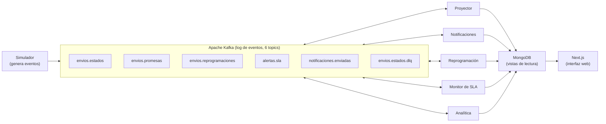
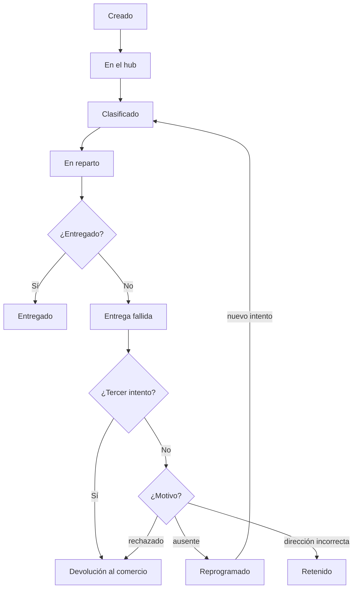
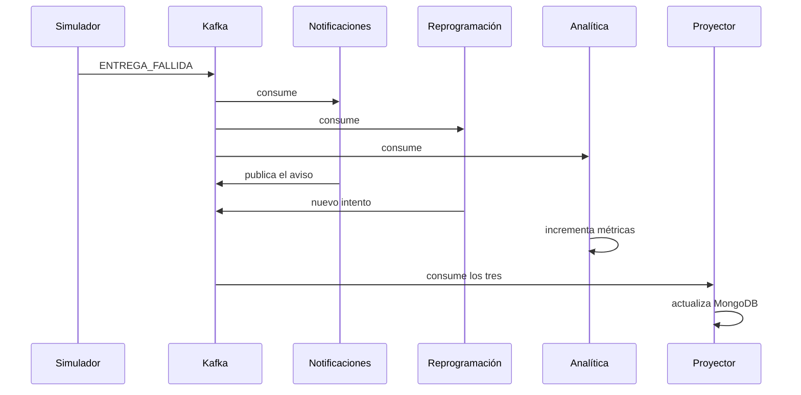
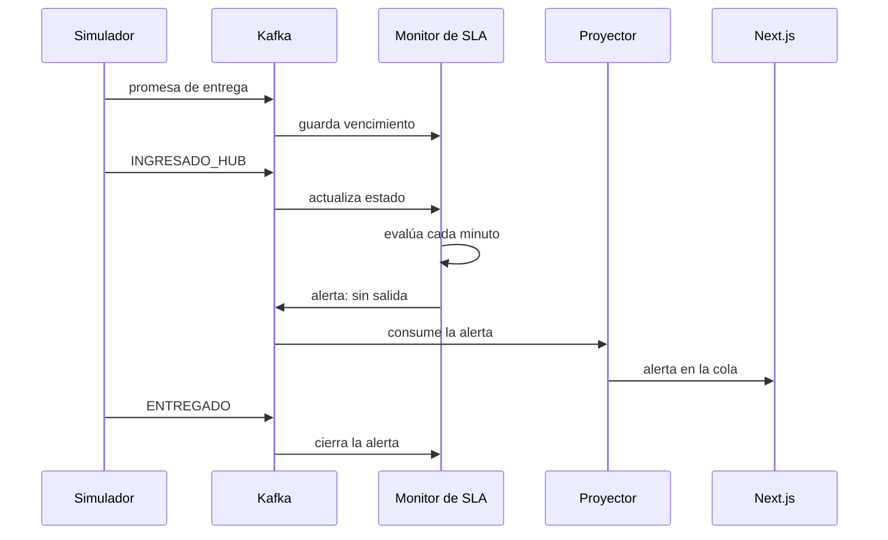

# RutaSur: especificación del caso práctico de logística orientada a eventos

**FCyT - Sede Concepción del Uruguay**  
**Licenciatura en Sistemas de Información**  
**Programación Avanzada - 2026**

---

## Resumen

La práctica construye una plataforma de seguimiento de envíos en tiempo real para un operador de última milla ficticio, de punta a punta: desde la generación de eventos hasta el tablero del supervisor.

**Hipótesis:** si cada cambio de estado de un envío se trata como un evento, la empresa puede intervenir durante la operación en lugar de analizar fracasos al día siguiente.

**Alcance funcional:** cuatro casos de uso encadenados en una sola historia.
1. Ciclo de vida del envío con tracking en vivo.
2. Entrega fallida con tres reacciones independientes.
3. Alerta temprana de riesgo de SLA.
4. Analítica de mejora con reprocesamiento de eventos.

**Stack:** Apache Kafka como log de eventos, Node.js para los servicios, MongoDB como modelo de lectura y Next.js para la interfaz. Todo corre en local con Docker Compose.

**Modalidad:** trabajo individual, un mes de desarrollo. Este documento describe qué construir y cómo se valida; no incluye código ni cronograma.

---

## Contexto de negocio

RutaSur es un operador de paquetería para e-commerce. Opera 3 centros de distribución, unos 120 repartidores y 15.000 envíos por día.

Sus sistemas (depósito, app del repartidor y atención al cliente) no comparten información. Los reportes salen de un proceso batch nocturno.

| Problema | Efecto en el negocio | Caso de uso que lo ataca |
| :--- | :--- | :--- |
| 18% de entregas fallan en el primer intento | Cada reintento duplica el costo del envío | Entrega fallida |
| Los incumplimientos de SLA se conocen al día siguiente | No hay margen para rescatar el envío | Riesgo de SLA |
| El tracking no es confiable | Llamados al centro de atención | Ciclo de vida |
| No se sabe dónde ni por qué se falla | Las decisiones de mejora se toman a ciegas | Analítica |

Las cifras son supuestos del caso, elegidos para dimensionar el simulador. No provienen de una empresa real.

---

## Alcance

Entra todo lo necesario para ejecutar la historia completa en una máquina, sin dependencias externas.

| Dentro del alcance | Fuera del alcance |
| :--- | :--- |
| Simulador de envíos con escenarios configurables | Integración con sistemas reales de depósito o transporte |
| Cuatro servicios consumidores independientes | Telemetría GPS y mapa en vivo |
| Proyección del estado en MongoDB | Optimización o reasignación de rutas |
| Detección de riesgo de SLA en tiempo real | Autenticación y gestión de usuarios |
| Torre de control y página pública de tracking | Envío real de correos o SMS (se registra la notificación) |
| Panel analítico con tres indicadores | Despliegue en la nube y alta disponibilidad |
| Reprocesamiento de eventos históricos | Pruebas de carga formales |

La telemetría y las rutas quedan afuera porque agregan volumen y un problema de optimización, pero ningún concepto nuevo de arquitectura de eventos.

---

## Arquitectura

Kafka es el único punto de contacto entre los servicios: ninguno llama a otro en forma directa. MongoDB recibe vistas derivadas y Next.js solo lee de ahí.

### Los servicios solo se comunican a través de Kafka

*Nota: Flecha doble indica que el servicio consume eventos y también publica los suyos.*

El simulador publica los eventos de origen. Cinco servicios los consumen en grupos independientes; tres de ellos publican eventos propios. El proyector y la analítica escriben las vistas que consulta la interfaz.

| Componente | Responsabilidad | Grupo de consumidores |
| :--- | :--- | :--- |
| Simulador | Genera envíos, promesas y cambios de estado | No consume |
| Proyector | Mantiene envíos, alertas y notificaciones en MongoDB | `proyector` |
| Notificaciones | Registra avisos al destinatario ante fallos y alertas | `notificaciones` |
| Reprogramación | Decide el próximo intento tras una entrega fallida | `reprogramacion` |
| Monitor de SLA | Detecta envíos en riesgo y emite alertas | `monitor-sla` |
| Analítica | Actualiza los agregados de `metricas_diarias` | `analitica` |
| Next.js | Torre de control, tracking público y panel analítico | No consume |

Cada servicio es un proceso Node.js separado. Eso permite detener uno durante la demo sin afectar a los demás.

---

## Catálogo de eventos

Seis topics cubren toda la práctica. La clave de partición es siempre el identificador del envío, lo que garantiza el orden de los eventos de un mismo paquete.

| Topic | Clave | Quién produce | Quién consume | Retención |
| :--- | :--- | :--- | :--- | :--- |
| `envios.estados` | `shipmentId` | Simulador | Proyector, monitor de SLA, notificaciones, reprogramación, analítica | 30 días |
| `envios.promesas` | `shipmentId` | Simulador | Monitor de SLA | Compactado |
| `envios.reprogramaciones` | `shipmentId` | Servicio de reprogramación | Proyector | 30 días |
| `alertas.sla` | `shipmentId` | Monitor de SLA | Proyector, notificaciones | 7 días |
| `notificaciones.enviadas` | `shipmentId` | Servicio de notificaciones | Proyector | 7 días |
| `envios.estados.dlq` | `shipmentId` | Cualquier consumidor | Revisión manual | 30 días |

### Estados del envío
El campo `tipo` de `envios.estados` toma uno de estos valores, en este orden habitual:
1. `CREADO`: el comercio registra el envío.
2. `INGRESADO_HUB`: el paquete llega al centro de distribución.
3. `CLASIFICADO`: queda asignado a una zona y a un repartidor.
4. `EN_REPARTO`: sale en el vehículo.
5. `ENTREGADO` o `ENTREGA_FALLIDA`: resultado del intento.

`ENTREGA_FALLIDA` lleva un motivo: `AUSENTE`, `DIRECCION_INCORRECTA`, `RECHAZADO` o `ZONA_INACCESIBLE`.

### Campos comunes a todo evento

| Campo | Propósito |
| :--- | :--- |
| `eventId` | Identificador único; permite descartar duplicados |
| `shipmentId` | Clave de partición y de correlación |
| `tipo` | Estado o tipo de evento |
| `ocurridoEn` | Momento en que pasó en el mundo real |
| `secuencia` | Número creciente por envío; permite detectar eventos fuera de orden |
| `hubId`, `zonaId`, `repartidorId` | Dimensiones para la analítica |
| `version` | Versión del esquema del evento |

Dos tiempos distintos importan: `ocurridoEn` lo fija el origen y el timestamp de Kafka indica cuándo llegó. La diferencia entre ambos es la demora de sincronización del repartidor.

---

## Modelo de datos en MongoDB

MongoDB guarda vistas derivadas de los eventos, no la fuente de verdad. Cualquier colección puede borrarse y reconstruirse leyendo Kafka desde el inicio.

| Colección | Contenido | Quién escribe | Índices |
| :--- | :--- | :--- | :--- |
| `envios` | Un documento por envío: estado actual, promesa, intentos, historial embebido, última secuencia aplicada | Proyector | `shipmentId` único; `estado` + `zonaId`; `promesa.venceEn` |
| `alertas` | Alertas de SLA abiertas y cerradas, con causa y prioridad | Proyector | `estado` + `prioridad`; `shipmentId` |
| `notificaciones` | Registro de cada notificación simulada | Proyector | `shipmentId` |
| `metricas_diarias` | Agregados por día, zona, hub y franja horaria | Servicio de analítica | `fecha` + `zonaId` + `franja` único |
| `eventos_procesados` | `eventId` ya aplicados por cada consumidor | Cada consumidor | `consumidor` + `eventId` único; TTL de 7 días |

El historial va embebido en el documento del envío porque está acotado (menos de 15 eventos) y siempre se lee junto con el estado.

`metricas_diarias` se actualiza con incrementos atómicos. Eso evita recalcular agregados sobre millones de documentos en cada consulta del tablero.

Los change streams de `envios` y `alertas` alimentan las actualizaciones en vivo de la interfaz. Requieren que MongoDB corra como replica set, aunque sea de un solo nodo.

---

## Casos de uso

### CU1: ciclo de vida del envío

El proyector consume `envios.estados` y mantiene el estado actual de cada envío en MongoDB. Es la base sobre la que se apoyan los otros tres casos.

#### Un fallo termina en reprogramación, retención o devolución

El flujo de estados tiene tres finales posibles. Un fallo por ausencia vuelve al circuito como nuevo intento; los demás motivos, o un tercer fallo, lo sacan de él.

- **Disparador:** cualquier evento de estado.
- **Resultado:** el documento del envío refleja el último estado y su historial completo.
- **Regla de orden:** un evento con secuencia menor o igual a la ya aplicada se descarta.
- **Regla de duplicados:** un `eventId` ya registrado no se vuelve a aplicar.
- **Evento inválido:** si no cumple el esquema, va a `envios.estados.dlq` con el motivo y el consumo continúa.
- **Conceptos que ejercita:** productor y consumidor, clave de partición, orden por partición, idempotencia y separación entre escritura y lectura (CQRS).

---

### CU2: entrega fallida

Un solo evento `ENTREGA_FALLIDA` provoca tres reacciones que no se conocen entre sí. Cada una es un grupo de consumidores distinto sobre el mismo topic.

#### Un evento de fallo dispara tres reacciones que no se conocen entre sí

Los tres servicios reciben el mismo evento en paralelo y ninguno espera a otro. El proyector consume después el fallo, el aviso y el nuevo intento, y los refleja en el documento del envío.

| Servicio | Reacción | Evento que emite |
| :--- | :--- | :--- |
| Notificaciones | Registra un aviso al destinatario con opciones para reprogramar | `notificaciones.enviadas` |
| Reprogramación | Asigna un nuevo intento según el motivo y el número de intentos | `envios.reprogramaciones` |
| Analítica | Suma el fallo a los agregados por zona, franja y motivo | Ninguno; escribe en `metricas_diarias` |

**Reglas de reprogramación:**
- `AUSENTE`: nuevo intento al día hábil siguiente, en la franja opuesta a la del fallo.
- `DIRECCION_INCORRECTA`: el envío queda retenido hasta una corrección; no se reprograma solo.
- `RECHAZADO`: se marca para devolución al comercio.
- Tercer intento fallido, cualquiera sea el motivo: devolución al comercio.

**Conceptos que ejercita:** grupos de consumidores independientes, desacople entre servicios, coreografía y manejo de errores con DLQ.

---

### CU3: riesgo de SLA

El monitor cruza el último estado de cada envío con su promesa de entrega y emite una alerta antes del vencimiento. Necesita evaluar el paso del tiempo, no solo reaccionar a eventos.

#### La alerta de SLA nace de evaluar el tiempo, no de un evento

La alerta no la dispara un evento sino su ausencia: pasa el tiempo sin que llegue `EN_REPARTO`. El proyector la escribe en MongoDB y la interfaz la recibe por el change stream.

| Regla | Condición | Prioridad |
| :--- | :--- | :--- |
| Sin ingreso | Faltan menos de 10 h para el vencimiento y no ingresó al hub | Media |
| Sin salida | Faltan menos de 4 h y no está en reparto | Alta |
| Fallo en el día límite | `ENTREGA_FALLIDA` y la promesa vence hoy | Alta |
| Vencido | Pasó el vencimiento sin `ENTREGADO` | Crítica |

- **Estado interno:** una tabla por envío con último estado y vencimiento, construida desde `envios.estados` y `envios.promesas`.
- **Evaluación:** al recibir cada evento y, además, cada minuto para todos los envíos abiertos.
- **Cierre:** cuando llega `ENTREGADO`, el monitor emite el cierre de la alerta.
- **Sin repetición:** una misma regla no vuelve a alertar sobre el mismo envío.
- **Conceptos que ejercita:** procesamiento con estado, cruce de dos streams, tiempo de evento frente a tiempo de proceso y tolerancia a reinicios.

---

### CU4: analítica de mejora

El servicio de analítica convierte los eventos en tres indicadores que responden preguntas de negocio concretas.

| Indicador | Pregunta que responde | Dimensiones |
| :--- | :--- | :--- |
| Tasa de entrega en primer intento | ¿Dónde y cuándo fallamos más? | Zona, franja horaria, día |
| Distribución de motivos de fallo | ¿Por qué fallamos? | Zona, motivo |
| Cumplimiento de SLA | ¿Qué hub llega tarde? | Hub, día |

El reprocesamiento se demuestra agregando un cuarto indicador con el sistema ya en marcha: **tiempo medio entre `INGRESADO_HUB` y `EN_REPARTO` por hub**. Un grupo de consumidores nuevo lee el topic desde el inicio y completa el histórico sin tocar los demás servicios.

**Conceptos que ejercita:** retención del log, offsets por grupo, reconstrucción de vistas y agregaciones incrementales.

---

## Simulador de eventos

El simulador reemplaza a los sistemas de origen y es parte del entregable: sin él no hay datos ni demo reproducible. Conviene construirlo primero.

| Parámetro | Para qué sirve | Valor sugerido |
| :--- | :--- | :--- |
| Envíos por minuto | Volumen de la demo | 20 |
| Factor de aceleración | Comprimir una jornada en minutos | 1 hora simulada = 30 segundos |
| Tasa de fallo por zona | Generar diferencias visibles en la analítica | Entre 5% y 30% |
| Distribución de motivos | Alimentar el indicador de motivos | 60% ausente, 20% dirección, 15% rechazo, 5% zona |
| Probabilidad de demora en hub | Disparar alertas de SLA | 10% |
| Probabilidad de duplicado | Probar la idempotencia | 2% |
| Probabilidad de evento fuera de orden | Probar la regla de secuencia | 2% |
| Probabilidad de evento malformado | Probar la DLQ | 1% |
| Semilla aleatoria | Repetir exactamente la misma corrida | Fija |

Además del flujo continuo, el simulador ofrece escenarios que se disparan a pedido durante la demo:
- **Envío feliz:** un envío recorre todos los estados sin incidentes.
- **Ausente:** un envío falla y se reprograma.
- **Demorado:** un envío queda detenido en el hub hasta generar una alerta.
- **Tercer fallo:** un envío agota sus intentos y pasa a devolución.
- **Ráfaga:** 500 envíos en pocos segundos, para ver acumulación y recuperación.

El factor de aceleración afecta a todo el sistema. El monitor de SLA debe usar el reloj simulado que viaja en los eventos, no el reloj de la máquina.

---

## Frontend en Next.js

La interfaz tiene cuatro pantallas de producto, más una vista auxiliar para la demo, y solo lee de MongoDB. Nunca consume Kafka en forma directa.

| Pantalla | Usuario | Qué muestra | Actualización |
| :--- | :--- | :--- | :--- |
| Torre de control | Supervisor | Contadores por estado, cola de alertas priorizada, últimos eventos | En vivo |
| Detalle del envío | Supervisor | Línea de tiempo, intentos, alertas y notificaciones del envío | En vivo |
| Tracking público | Destinatario | Estado actual y fecha estimada, sin datos internos | En vivo |
| Analítica | Gerencia | Los indicadores de CU4 con filtros por zona, hub y fecha | Al cargar |
| Panel de demo | Quien presenta | Botones para disparar los escenarios del simulador | No aplica |

Las actualizaciones en vivo viajan por Server-Sent Events desde un route handler que escucha los change streams. Se elige SSE sobre WebSocket porque el flujo es de un solo sentido y no requiere infraestructura adicional.

Las pantallas de datos se renderizan en el servidor y un componente cliente aplica los cambios que llegan. La analítica usa agregaciones sobre `metricas_diarias`, que ya está precalculada.

---

## Decisiones de diseño

Estas son las decisiones que conviene poder justificar en la defensa del trabajo.

| Decisión | Elección | Motivo | Alternativa descartada |
| :--- | :--- | :--- | :--- |
| **Garantía de entrega** | Al menos una vez, con consumidores idempotentes | Es simple y no pierde eventos | Exactamente una vez con transacciones: más complejo de lo que el caso necesita |
| **Confirmación de offsets** | Manual, después de escribir en MongoDB | Un fallo a mitad de proceso reintenta el evento | Confirmación automática: puede perder eventos |
| **Particiones de `envios.estados`** | 3 | Alcanza para mostrar reparto de carga y rebalanceo | 1 partición: no permite demostrar paralelismo |
| **Formato de eventos** | JSON con validación de esquema en cada consumidor | Legible y sin componentes extra | Avro con Schema Registry: queda como extensión |
| **Monitor de SLA** | Consumidor propio con estado en memoria y respaldo en MongoDB | La lógica queda a la vista y es fácil de explicar | Kafka Streams o ksqlDB: queda como extensión |
| **Kafka en local** | Un broker en modo KRaft | Un solo contenedor, sin ZooKeeper | Clúster de 3 brokers: solo si se quiere mostrar replicación |
| **Tiempo real en la interfaz** | Change streams más SSE | El frontend no depende de Kafka | Consumir Kafka desde Next.js: acopla la interfaz al broker |

---

## Requisitos no funcionales

- **Latencia:** un evento se ve en la torre de control en menos de 2 segundos.
- **Recuperación:** un consumidor detenido retoma desde su último offset sin perder ni duplicar efectos.
- **Reconstrucción:** borrar una colección y reprocesar el topic deja el mismo resultado.
- **Aislamiento:** la caída de un servicio no detiene a los demás.
- **Observabilidad:** cada servicio registra `eventId`, partición y offset, y se puede consultar el lag de cada grupo.
- **Arranque:** todo el entorno se levanta con un solo comando.

---

## Guion de la demo

La demo dura unos 15 minutos y recorre los cuatro casos de uso más dos fallos provocados. Cada paso muestra un resultado de negocio y un concepto técnico.

1. **Arranque.** Se levanta el entorno y el simulador comienza el flujo continuo. La torre de control muestra los contadores moviéndose.
2. **Envío feliz.** Se dispara el escenario y se sigue un envío en el tracking público hasta `ENTREGADO`. *Concepto: productor, consumidor y proyección.*
3. **Ausente.** Se dispara el escenario. En el detalle del envío aparecen, casi a la vez, la notificación, la reprogramación y el incremento en analítica. *Concepto: tres grupos de consumidores sobre un mismo evento.*
4. **Demorado.** Un envío queda detenido en el hub. Con el reloj acelerado, la alerta aparece en la cola con prioridad alta antes del vencimiento. *Concepto: procesamiento con estado y tiempo.*
5. **Caída de un servicio.** Se detiene el servicio de notificaciones. El tracking y las alertas siguen funcionando y el lag del grupo crece. Al reiniciarlo, procesa lo pendiente sin duplicar avisos. *Concepto: aislamiento, offsets e idempotencia.*
6. **Evento inválido.** Se inyecta un evento malformado. Aparece en la DLQ y el resto del flujo no se detiene. *Concepto: manejo de errores.*
7. **Analítica.** Se abre el panel y se identifica la zona y la franja con más fallos. Se plantea la mejora: ofrecer franja vespertina en esa zona.
8. **Reprocesamiento.** Se activa el cuarto indicador. Un grupo nuevo lee el histórico y el gráfico se completa con datos anteriores a su creación. *Concepto: retención y replay.*

Los pasos 5 y 8 son los que distinguen esta solución de una basada en una cola tradicional o en llamadas REST encadenadas.

---

## Criterios de aceptación

El trabajo está completo cuando se cumplen estas condiciones verificables.

### Ciclo de vida
- [ ] Un envío simulado aparece en la torre de control y en el tracking público con su estado correcto.
- [ ] Un evento duplicado no agrega una entrada repetida al historial.
- [ ] Un evento fuera de orden no hace retroceder el estado del envío.
- [ ] Un evento malformado termina en la DLQ con su motivo.

### Entrega fallida
- [ ] Un `ENTREGA_FALLIDA` genera exactamente una notificación y una reprogramación.
- [ ] Cada motivo aplica su regla de reprogramación.
- [ ] El tercer fallo marca el envío para devolución.
- [ ] Detener un servicio no afecta a los otros dos.

### Riesgo de SLA
- [ ] Cada una de las cuatro reglas genera su alerta con la prioridad definida.
- [ ] Una misma regla no alerta dos veces sobre el mismo envío.
- [ ] La alerta se cierra cuando el envío se entrega.
- [ ] Tras reiniciar el monitor, no se pierden ni se repiten alertas.

### Analítica y reprocesamiento
- [ ] Los tres indicadores coinciden con un recuento manual sobre una corrida con semilla fija.
- [ ] El cuarto indicador se completa con datos históricos sin reiniciar los demás servicios.
- [ ] Borrar envíos y reprocesar deja la colección en el mismo estado.

### Entorno
- [ ] Todo el sistema se levanta con un solo comando en una máquina limpia.
- [ ] La latencia entre evento y pantalla es menor a 2 segundos con el flujo continuo.

---

## Extensiones opcionales

Si sobra tiempo, estas ampliaciones suman conceptos sin rehacer lo construido. Están ordenadas de menor a mayor esfuerzo.

| Extensión | Qué agrega | Se apoya en |
| :--- | :--- | :--- |
| Paquetes dormidos en hub | Detectar la ausencia de un evento esperado | El estado del monitor de SLA |
| Kafka Connect con sink a MongoDB | Una proyección sin código propio, para comparar con el proyector | CU1 |
| Schema Registry con Avro | Evolución de esquemas y compatibilidad entre versiones | El catálogo de eventos |
| Monitor de SLA en Kafka Streams o ksqlDB | La herramienta específica de procesamiento de streams | CU3 |
| Clúster de 3 brokers | Replicación y caída de un broker | El entorno Docker |
| Telemetría y mapa en vivo | Alto volumen, topic compactado y consultas geoespaciales | Una colección time series nueva |